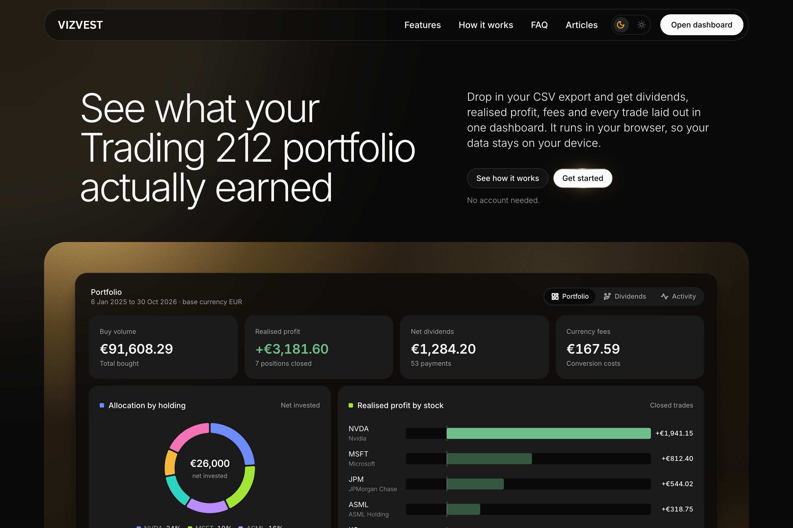
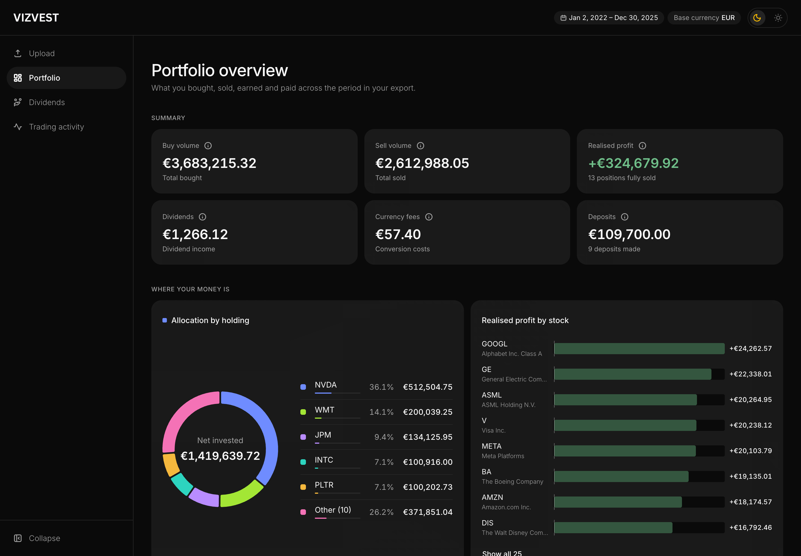

# Vizvest

Portfolio analytics for Trading 212. Upload a CSV export and see your holdings, realised profit, dividends, fees and trading habits. Everything is processed in your browser.





## Why I built this

I was sick of not seeing the full picture of my portfolio on Trading 212. The platform is great for buying and selling, but its analytics are close to nonexistent. There's no breakdown of realised and unrealised gains, no dividend history worth looking at, and no way to see how your trading activity shapes your returns.

So I built Vizvest, the dashboard I wished Trading 212 had. Drop in your CSV export and get the views the platform should have shipped with.

## Features

- Portfolio overview with buy and sell volume, realised profit, dividends, currency fees, deposits and allocation by holding.
- Realised profit per position, taken from Trading 212's own figures.
- A cost view that adds up currency conversion fees and withholding tax, so the return you see is the one you kept.
- Dividends by month and quarter, net of the tax withheld at source.
- A per-stock page with the full buy, sell and dividend history of any holding.
- Trading activity with a day-by-day heatmap, streaks, your busiest month and your win rate.
- Multi-file uploads. Trading 212 caps exports at 12 months per file, so you can drop several at once. Vizvest merges them, removes overlapping transactions and asks you to pick a base currency if the files disagree.
- Currency normalisation. Vizvest detects your base currency and converts every row at the FX rate already in the CSV, pence included.
- Partial export detection. You get a warning when sells outrun buys, which usually means the export window is too short.
- Light and dark themes.
- No backend. Nothing is uploaded or stored, and refreshing the page clears your data.

## Tech stack

- Next.js 16 (App Router) and TypeScript
- Zustand for state
- Tailwind CSS with shadcn/ui and Radix UI primitives
- PapaParse for CSV parsing
- In-house SVG and CSS charts in `components/charts`, with no chart library
- Keyline Icons, generated into `components/icons`
- CSS transitions in `components/motion`, plus Framer Motion in a few places
- next-themes for light and dark mode
- MDX articles via next-mdx-remote and remark-gfm
- Vitest for tests

## Design system

The landing page, dashboard and articles share one design language.

- Tokens live in `app/globals.css` and `tailwind.config.ts`. There's one font (Inter), one bronze accent, colours for up, down and warning, and six fixed chart colours.
- Dashboard figures and charts sit on `Tile` surfaces (`components/ui/tile.tsx`). Standalone content uses `Card`. Every button is a pill.
- Charts are plain components in `components/charts`. Dashboard pages are built from `DashboardPage`, `PageHeader` and `Region` in `components/features/dashboard-layout.tsx`.
- Motion wrappers in `components/motion` use the transitions in `app/styles/transitions.css` and respect `prefers-reduced-motion`.
- Icons come from the Keyline set. To add one, put its name in `scripts/generate-icons.mjs` and run `npm run icons`.

## Getting started

```bash
npm install
npm run dev
```

Open [http://localhost:3000](http://localhost:3000).

```bash
npm run build    # production build
npm run lint     # ESLint
npm run test     # Vitest
npm run icons    # regenerate components/icons from scripts/generate-icons.mjs
```

## Usage

1. Export your Trading 212 transaction history as CSV. Export as many date ranges as you need, since each file covers at most 12 months.
2. Go to `/dashboard`.
3. Drop in one or more CSVs, review the staged list, add or remove files, then press **Continue**.
4. Explore your portfolio, dividends and trading activity.

## CSV format

Required columns are `Action`, `Ticker`, `No. of shares`, `Price / share`, `Total`, `Currency (Total)` and `Exchange rate`.

Each file can be up to 5 MB and must be a CSV. You can upload several files at once, and duplicate transactions across them are removed automatically.

## Disclaimer

Vizvest is an educational and visualisation tool for personal use. It is not financial advice. Talk to a licensed professional before making investment decisions.
